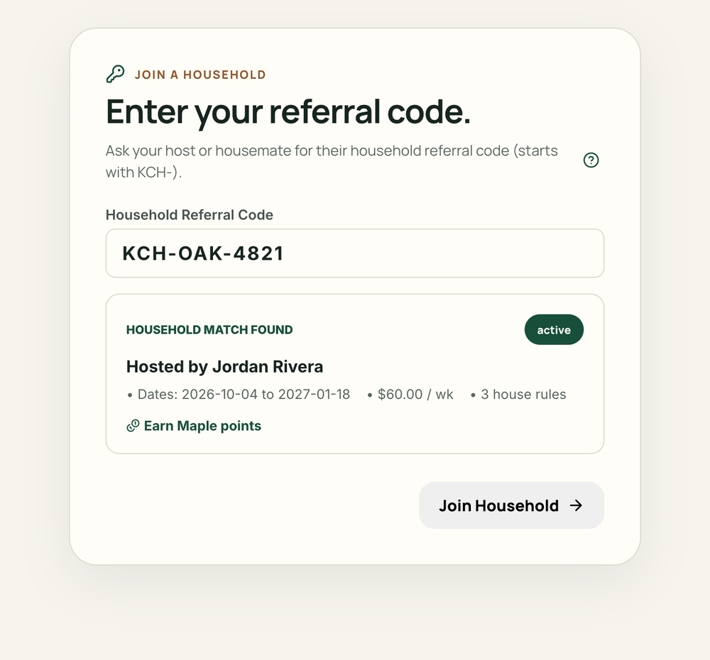

<Tip>
  Each guest has an individual agreement and a private financial ledger. Household guidelines and chores are shared with all stay members, but your payment details remain strictly between you and your host.
</Tip>

Your host can invite multiple guests to a household, with each guest receiving their own tailored agreement terms.

## Join with a link or code

You can join a stay using either a private invitation link or the invite code your host shared. Codes start with `KCH-`.

<Steps>
  <Step title="Open your invitation">
    Click the private invitation link your host sent you. If you have a code instead, visit [Kouchd](https://app.kouchd.com). When you're signed out, enter the code on the Start page. If you already have an account, sign in and choose **Join with code**.
  </Step>
  <Step title="Enter household referral code">
    If you entered the code while signed out, Kouchd carries it through account creation and fills it in on the join screen. Otherwise, enter the exact code your host shared. A preview of the stay appears so you can check its details before joining.
  </Step>
  <Step title="Confirm household preview and join">
    Verify the host name, dates, and rate match what you discussed, then select **Join Household** to activate your membership.
  </Step>
  <Step title="Review house guidelines and terms">
    In the onboarding flow that follows, review the full house guidelines (quiet hours, kitchen rules, and visitor policies) and your individual stay dates and contribution terms.
  </Step>
</Steps>

<Accordion title="On iPhone" icon="smartphone">
  - **Invitation link:** Tap the link your host sent. The app opens, asks you to sign in if needed, and shows the invitation.
  - **Referral code:** Go to **Stay** › **Join another stay** (or choose **Join with a code** on the welcome screen if you don't have a stay yet), enter the code, and tap **Join**.
  - If your agreement needs review, Home shows **Your agreement needs review** with a **Review agreement** link.

  See [Getting started on iPhone](/help/ios/using-kouchd-on-ios). The iPhone app is in development and not yet on the App Store.
</Accordion>

## Review and accept your agreement

During onboarding, review your individual agreement terms in detail:

- **Stay dates**: Your specific check-in and check-out dates.
- **Contribution rate & cadence**: The agreed dollar amount and whether it is logged daily or weekly.
- **Grace periods & late fees**: Any agreed buffer before an overdue fee applies.
- **House guidelines**: Detailed quiet hours and shared household standards.

<Info>
  **Private & independent:** Your agreement applies strictly to you. Other guests in the home cannot view your rates, charges, contributions, or ledger.
</Info>

When the details match what you discussed with your host, select **Accept Terms & Enter Household** to complete your check-in. If your host configured a waiting window, you can accept immediately or review the terms during that window before the agreement activates.

<Info>
  **Door and Wi-Fi codes:** If your host added a door code or Wi-Fi password, you'll see them once your agreement is accepted: by you, or automatically after the waiting window if your host turned that on. They're hidden again after the stay ends. If you leave and later rejoin, you get a new agreement, and the codes show again once it's accepted, by you or automatically if your host has that turned on.
</Info>

<Tip>
  **Need technical help joining?** Contact support via our [contact form](https://kouchd.com/contact) if you run into login or screen errors. If you have questions about the house rules, rates, or living expectations, talk directly with your host before accepting.
</Tip>

## After joining

- Use **Home** to see confirmed contribution progress, stay countdowns, and recent activity.
- Use **Ledger** to view upcoming obligation dates and record payments you make to your host.
- Use **Chores** to coordinate shared household tasks and pitch in.
- Use **Stay** to review your host's external payment handles, house guidelines, and door and Wi-Fi codes.

<CardGroup cols={2}>
  <Card title="Logging contributions" icon="receipt" href="/help/guests/logging-contributions">
    Record external payments and track confirmation progress.
  </Card>
  <Card title="Kouchd Coins and house rewards" icon="coins" href="/help/guests/kouchd-coins">
    Submit reward claims for chores and shared contributions.
  </Card>
  <Card title="Email and text reminders" icon="bell" href="/help/notifications/notification-preferences">
    Configure email and optional text reminders.
  </Card>
  <Card title="Privacy, data, and security" icon="shield-check" href="/help/legal-trust/privacy-and-security">
    Learn how Kouchd protects your personal information and ledger boundaries.
  </Card>
</CardGroup>
