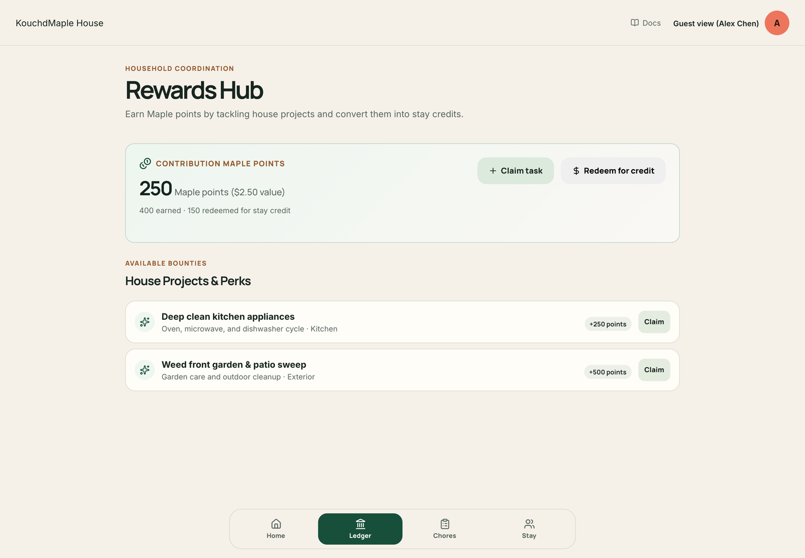

<Tip>
  Got a guest who loves baking cookies or a housemate willing to power-wash the patio? **Kouchd Coins** are a fun way to recognize the extra effort people put into making a home welcoming. Approved tasks earn coins that convert into stay credits or fun household perks!
</Tip>

When a host enables household rewards, guests can take on extra chores or home improvement projects, submit a quick completion note, and redeem their coins toward agreed stay contributions.

## How Kouchd Coins work

1. **Host sets up the bounty**: The host names the stay points (such as "Maple points"), assigns coin values to specific household contributions (such as 250 points for deep cleaning the fridge, or 500 points for weeding the garden), and defines the conversion rate (e.g., 100 points = $1.00 credit).
2. **Guest tackles the task**: The guest pitches in and takes care of the project.
3. **Submit a claim**: The guest submits a quick claim with a note describing the accomplishment.
4. **Host approval & credit**: The host approves the claim, adding coins to the guest's balance. When redeemed, the credit applies directly to the guest's contribution ledger.

<Accordion title="On iPhone (TestFlight Beta)" icon="smartphone">
  1. Open the **More** tab at the bottom of the screen.
  2. Under **Your stay** (or **Manage this stay** if you are hosting), select **Contribution rewards**.
  3. View your available stay points, dollar equivalent, and pending claims.
  4. Enter what you did, the points, and details, then tap **Submit for review**.
</Accordion>

## Submit a reward claim

<Steps>
  <Step title="Locate household rewards">
    Navigate to **Ledger** and locate the rewards overview card, labeled with your stay's coin name (for example, **Contribution Maple points**).
  </Step>
  <Step title="Tap Claim task">
    Select **+ Claim task** to open the task claim modal.
  </Step>
  <Step title="Select an available bounty">
    Choose the task or project your host has posted (for example, "Deep clean kitchen appliances" or "Mow the lawn"), or enter custom contribution details.
  </Step>
  <Step title="Add completion details & submit">
    Add a note describing what was completed and submit the claim for host review and approval.
  </Step>
</Steps>

## Redeem approved rewards

Once your host approves a claim, your available coin balance increases.

- **Redemption**: When you are ready to apply your points toward your stay balance, select **Redeem for credit** on the rewards card.
- **Credit application**: Redeemed credits are immediately recorded as confirmed contributions on your ledger.

<CardGroup cols={2}>
  <Card title="House rules and chores" icon="clipboard-check" href="/help/hosts/house-rules-and-chores">
    Coordinate everyday household tasks and responsibilities.
  </Card>
  <Card title="Logging contributions" icon="receipt" href="/help/guests/logging-contributions">
    Learn how to record contributions and track confirmation status.
  </Card>
</CardGroup>
