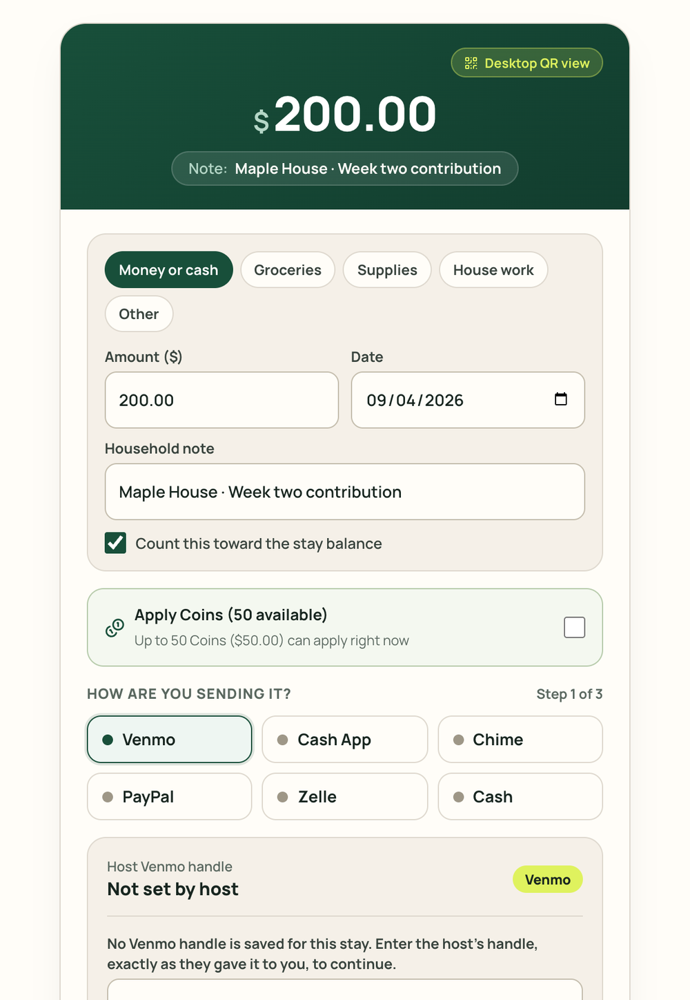

<Tip>
  The ledger is a transparent mutual record between you and your host. When you pitch in for groceries or send an agreed contribution, you log it here. Once confirmed, credits apply to your stay balance.
</Tip>

Kouchd keeps a clear record of contributions; it does not process payments. You and your host use the ledger to keep a shared, accurate record of what was agreed and confirmed.

## Send contributions directly to your host

<Info>
  **Direct contribution methods:** Open the **Stay** tab to view the direct payment handles your host provided for PayPal, Cash App, Zelle, Venmo, or Apple Pay. Always verify account handles before sending funds.
</Info>

Kouchd does not collect or transfer money directly, so contributions sent outside the app are recorded here so everyone has the same clear record.

## Record a contribution

<Steps>
  <Step title="Open Ledger and select Add contribution">
    Navigate to **Ledger** in your app navigation and select the **+ Add contribution** button.
  </Step>
  <Step title="Choose contribution category">
    Select the category that best describes your contribution:
    - **Direct contribution**: Funds sent directly via PayPal, Cash App, Zelle, Apple Pay, or cash.
    - **Groceries & pantry**: Shared food, dinner ingredients, or coffee restocks agreed with your host.
    - **Household supplies**: Cleaning supplies, paper goods, or everyday essentials.
    - **Other agreed help**: Special shared costs discussed with your host.
  </Step>
  <Step title="Enter amount and date">
    Enter the exact dollar amount and select the date the contribution was sent or the purchase was made.
  </Step>
  <Step title="Add a note and submit">
    Add a friendly note (such as "Week 2 contribution sent via Zelle" or "Trader Joe's run") to help your host quickly identify and verify the entry. Select **Record contribution**.
  </Step>
</Steps>

<Accordion title="On iPhone (TestFlight Beta)" icon="smartphone">
  1. Tap **Ledger**, then tap **Record a contribution** (or **+**).
  2. Choose a **Type**: Outside contribution, Groceries, Supplies, House work, or Other.
  3. Enter the amount in dollars and an optional note.
  4. Leave **Count toward balance** on if it should reduce what's agreed, then tap **Record**.

  The record shows as **pending** until the other person confirms it.

  See [Ledger and contributions on iPhone](/help/ios/ledger-and-contributions). The native iPhone app is releasing soon via TestFlight (version 0.9.x) for interested beta testers.
</Accordion>

<Tip>
  **Bought something on the shopping list?** In the web app, check off the shared item and choose **Log contribution**. **Add contribution** opens with the item filled in, and you enter the amount. Personal items don't offer this.
</Tip>

## Understanding confirmation status

- **Pending confirmation**: The entry is logged on your ledger and is visible to your host. Pending entries do not count toward confirmed progress until your host reviews them.
- **Confirmed**: Your host has verified the contribution or grocery receipt. The credit is immediately applied to your stay balance.
- **Unconfirmed or mismatched entries**: If an entry's details require adjustment, leave it unconfirmed and coordinate with your host to re-record the contribution with the agreed amount and date. Kouchd does not mediate disputes or handle external payment issues between members.

## Reading your progress display

The progress bar on **Home** and **Ledger** shows confirmed contributions against agreed stay cadences, along with your remaining balance and upcoming dates.

<Note>
  **Fair credit priority:** Once confirmed, contributions automatically apply to the earliest scheduled contribution period first to keep accounting straightforward.
</Note>

<CardGroup cols={2}>
  <Card title="Quickstart guide" icon="bolt" href="/help/quickstart">
    Overview of household setup and contribution tracking.
  </Card>
  <Card title="Kouchd Coins and house rewards" icon="coins" href="/help/guests/kouchd-coins">
    Earn ledger credits through approved chores and household tasks.
  </Card>
  <Card title="Stay terms and contributions" icon="circle-dollar-sign" href="/help/hosts/stay-terms-and-contributions">
    Understand contribution cadences, house guidelines, and buffers.
  </Card>
  <Card title="Privacy, data, and security" icon="shield-check" href="/help/legal-trust/privacy-and-security">
    Review visibility and bilateral ledger access boundaries.
  </Card>
</CardGroup>
