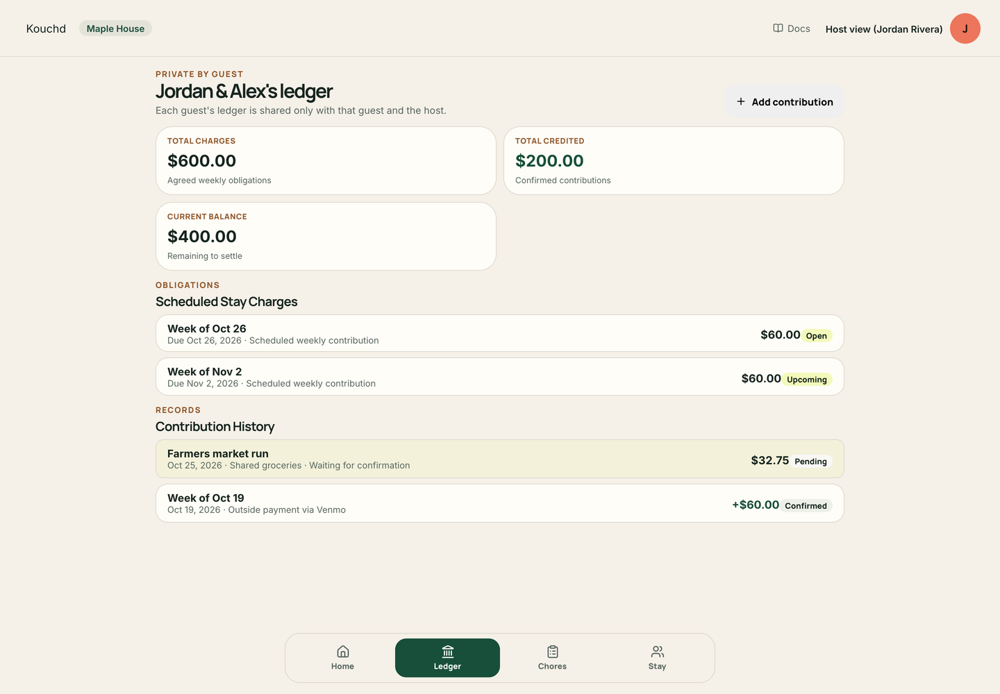
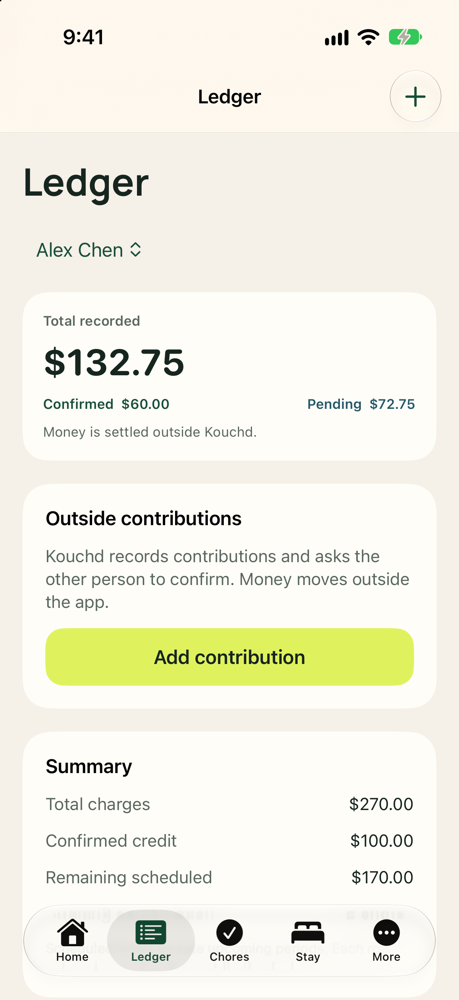

<Tip>
  The ledger is a mutual, transparent record between host and guest. Each guest has an independent financial ledger that is strictly private between that guest and the host.
</Tip>

## Review a guest’s ledger

Open **Ledger** from the main navigation. If your stay has multiple guests, select the guest whose records you want to review.

The ledger shows scheduled charges, due dates, confirmed credits, pending entries, and remaining balances, along with a visual progress bar indicating overall payment health.

## Confirm a contribution

When a guest sends a payment outside Kouchd or covers an agreed shared expense (such as groceries or home supplies), they record it by choosing **Add contribution**. A new entry stays pending until you review and confirm it.

<Steps>
  <Step title="Review the pending contribution">
    Open **Ledger** and locate the entry tagged with **Pending confirmation**. Check the contribution category, reported dollar amount, date, and any attached note.
  </Step>
  <Step title="Verify outside receipt">
    Confirm that the funds arrived in your external payment account (PayPal, Cash App, Zelle, Apple Pay, or direct bank transfer) or verify the grocery receipt.
  </Step>
  <Step title="Confirm in Kouchd">
    Select **Confirm**. The status updates to **Confirmed**, and the credit is immediately applied to the guest’s oldest outstanding charge.
  </Step>
</Steps>

<Info>
  **What if details do not match?** If the amount, date, or category does not match what you received or agreed, do not confirm the entry. Leave it unconfirmed and discuss the transaction directly with your guest so they can record a corrected contribution. Kouchd does not collect payments or mediate financial disagreements between household members.
</Info>

<Accordion title="On iPhone (TestFlight Beta)" icon="smartphone">
  - Tap **Ledger**. If you host more than one guest, pick the guest at the top with the switcher dropdown to maintain bilateral privacy.
  - Under **Contribution records**, a guest's pending entry shows **Confirm** and **Dispute** buttons. Tap **Confirm** when it matches what you received, or **Dispute** if it doesn't, then talk it through.
  - If a record was entered wrong, tap **Void record** and have it recorded again correctly.

  

  See [Ledger and contributions on iPhone](/help/ios/ledger-and-contributions). The native iPhone app is releasing soon via TestFlight (version 0.9.x) for interested beta testers.
</Accordion>

## Record a shared expense or adjustment

Hosts and guests can record agreed shared expenses or balance adjustments directly on the ledger:

- **One-time shared expenses**: If you agreed to record shared groceries, bulk household supplies, or an emergency plumbing fix, select **Add contribution**, choose the category (such as Supplies or Groceries), enter the amount, and include a clear note.
- **Voiding or correcting an entry**: If an entry was logged incorrectly or resolved outside the ledger, you can void or adjust it with a helpful explanation so the history remains clear.

<Warning>
  **Outside transactions only:** Kouchd records reported agreements and contributions. It does not process monetary transactions or verify that money moved in external bank accounts.
</Warning>

<CardGroup cols={2}>
  <Card title="Stay terms and contributions" icon="circle-dollar-sign" href="/help/hosts/stay-terms-and-contributions">
    Configure guest stay dates, contribution cadences, and grace buffers.
  </Card>
  <Card title="Logging contributions" icon="receipt" href="/help/guests/logging-contributions">
    See how guests record contributions and track confirmation status.
  </Card>
</CardGroup>
