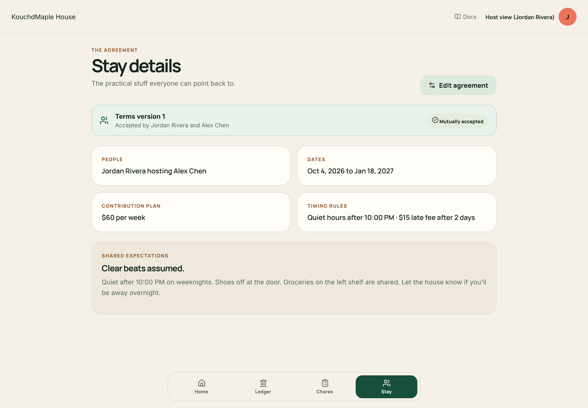
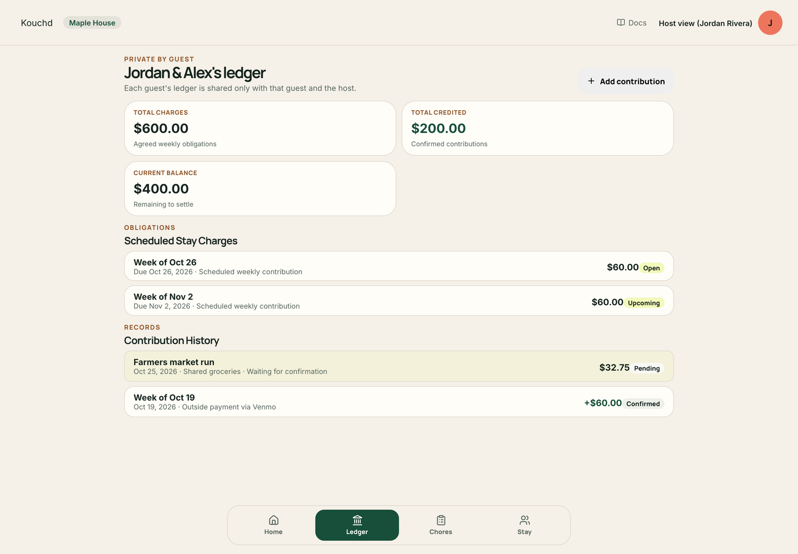

<Tip>
  Shared living works best when everyone knows what to expect before bags are unpacked. Kouchd keeps financial expectations clear and transparent without ever touching your money. Hosts and guests agree on contributions, house notes, and chores—so no one has to have awkward money conversations over morning coffee.
</Tip>

## Household defaults and guest agreements

When setting up a stay, the host establishes the general rhythm of the house. Each invited guest receives a personalized copy of these terms to review and accept before their visit begins. Hosts can tailor terms for each guest:

- **Stay dates**: Set arrival and departure dates tailored to each guest's visit.
- **Contribution amount**: Agree on a fair contribution (daily, weekly, or a flat stay contribution) for shared utilities, groceries, or space.
- **Contribution cadence**: Pick when contributions are logged (daily or on an agreed weekday).
- **Grace buffers**: Life happens! Agree on a friendly buffer period (like 2 or 3 days) so if a bank transfer takes a weekend to clear, everyone stays relaxed.
- **Early contribution discounts**: Optionally recognize early contributions with an agreed credit discount.

House rules (like quiet hours and guest policies) remain shared across the home, while each guest’s financial ledger stays completely private between that guest and the host.

<Info>
  **Door and Wi-Fi codes:** Guests see the door code and Wi-Fi password you add only after their agreement is accepted, and they stay visible until the stay ends. If a guest leaves and rejoins, they get a new agreement, and the codes show again once it's accepted. With automatic acceptance on, that happens on its own after your waiting window; turn it off if you want each returning guest to accept themselves. You always see your own codes.
</Info>

## Tracking contributions on the Ledger

The **Home** and **Ledger** screens keep things refreshingly simple. They show confirmed contributions, upcoming cadences, and what has been settled:

- **Confirmed progress**: The progress bar visually shows what share of agreed contributions has been confirmed.
- **Splitting costs & partial contributions**: If a guest covers a grocery run or pitches in partial amounts, the host can confirm the credit immediately on the ledger.
- **Pending entries**: Contributions logged by guests stay pending until the host gives them a quick thumbs-up.

<Info>
  **Fair credit priority:** When a contribution is confirmed, Kouchd automatically applies the credit to the earliest scheduled cadence first, keeping the math clean and simple.
</Info>

## Flexible adjustments without awkwardness

Real life doesn't always follow a spreadsheet. If travel plans change or someone helps out with a big project:

- **Adjusting an entry**: If dates change or an amount needs updating, hosts and guests can adjust or void records with a brief friendly note.
- **Communication first**: Always chat directly about schedule or contribution shifts. Kouchd is the notebook that remembers what you agreed to—it never enforces or penalizes anyone.

## Contributions happen outside Kouchd

<Warning>
  **Kouchd never handles your money:** Kouchd does not collect, hold, transfer, process, or escrow funds. It never links to your bank account or charges debit cards.
</Warning>

Hosts can list their preferred external payment handles (PayPal, Cash App, Zelle, Venmo, or Apple Pay) directly in the **Stay** tab. Guests send funds directly through their preferred payment app, then log the contribution in Kouchd. The Ledger is your shared proof of clarity, not a bank.

## Kouchd Coins and house perks

Want to reward someone for deep-cleaning the fridge, weeding the garden, or walking the dog? Hosts can enable **Kouchd Coins**:

- **House coin value**: The host sets how many coins a task is worth (e.g., 200 coins for mowing the lawn) and what credit it provides.
- **Redeeming for credit**: When a guest completes a task and the host approves the claim, coins convert into contribution credits on their stay ledger—or fun household perks!

<CardGroup cols={2}>
  <Card title="Managing the ledger" icon="receipt" href="/help/hosts/ledger-management">
    How to review contributions, confirm entries, and keep records accurate.
  </Card>
  <Card title="Stay agreements and house rules" icon="file-text" href="/help/legal-trust/stay-agreements">
    How agreements, house notes, and privacy boundaries work.
  </Card>
</CardGroup>
