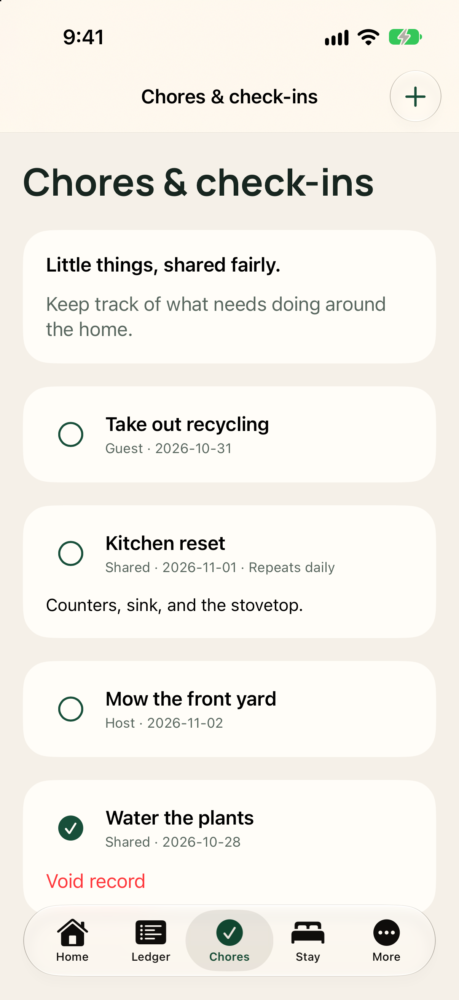
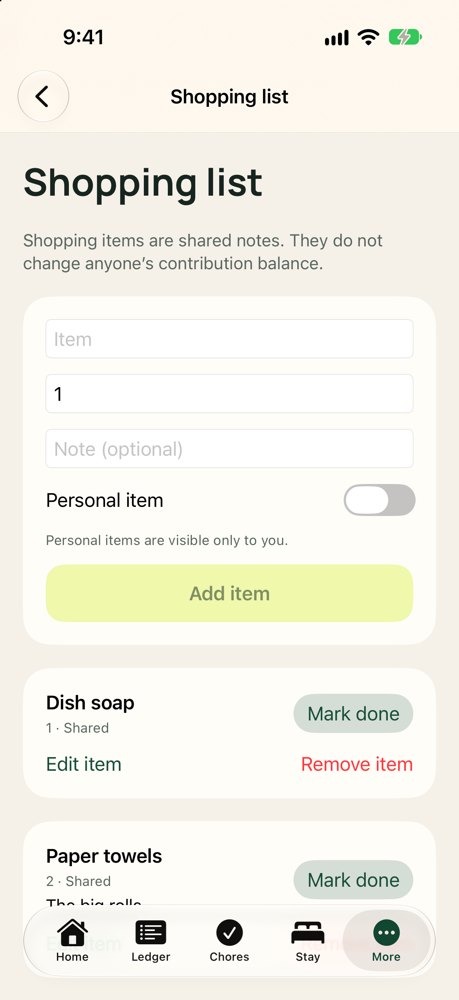
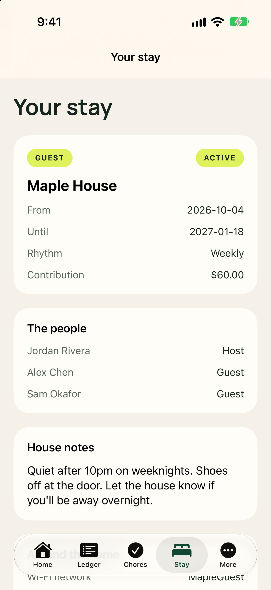
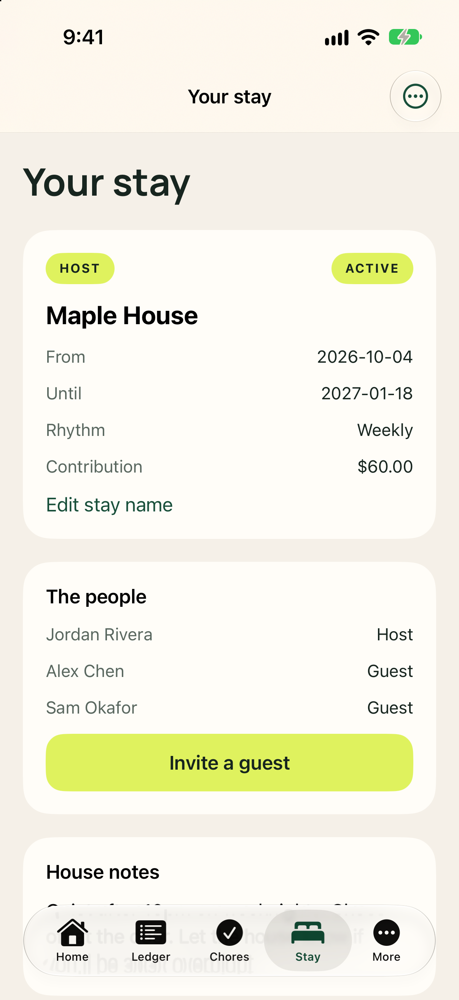

The **Chores** and **Stay** tabs keep household expectations, daily responsibilities, and practical living details easy to reference from your phone.

## Household chores

Tap **Chores** along the bottom of the screen to see active responsibilities. Each chore shows who it is assigned to (Shared, Host, or Guest) and its target due date.

- **Mark a chore done:** Tap the circle next to the task name. Tap again to mark it incomplete if needed.
- **Add a chore:** Tap **Add a chore** (or the **+** button at the top right). Enter a title, optional details, assign it (Shared, Host, or Guest), pick a due date, and tap **Add**.
- **Occupied nights:** Tap the **Occupied nights** link at the bottom of the screen to view dates where household nights have been logged.

## Shared shopping lists

Open the **More** tab and select **Shopping list** to manage household items and personal needs:

- **Shared items:** Keep household essentials (like dish soap, olive oil, and coffee filters) visible to everyone.
- **Personal items:** Keep private items visible only to you.
- **Add item:** Tap **Add item** to record item names, quantities, and notes.

## Stay guidelines and house notes

The **Stay** tab gathers everything you need to know about the home and the people sharing it.

- **Stay details:** Scheduled dates, the contribution rhythm (daily or weekly), and agreed rates.
- **Household members:** Everyone currently in the stay and their assigned roles.
- **Around the home:** Wi-Fi network and password, front door codes, parking directions, and trash collection days. Guests see the door code and Wi-Fi password once their agreement is accepted, until the stay ends.
- **Pay outside Kouchd:** Direct payment handles provided by the host (such as PayPal, Cash App, Apple Pay, or Zelle). Pay using one of these options, then record the entry in the Ledger tab. Contribution records do not prove that money moved.
- **More for your stay:** Quick links to review your guest agreement, request schedule changes, check Kouchd Coins rewards, and view household activity.

## Host stay controls

Hosts can tap **Invite a guest** on the Stay tab or access the **⋯** menu to edit stay details. Hosts can also open stay settings to adjust household parameters or view invite codes.

## Related guides

<CardGroup cols={2}>
  <Card title="Getting started on iPhone" icon="mobile" href="/help/ios/using-kouchd-on-ios">
    App navigation, 5 tabs, and reminder preferences.
  </Card>
  <Card title="Ledger & contributions on iPhone" icon="receipt" href="/help/ios/ledger-and-contributions">
    Logging payments, confirming records, and balance management.
  </Card>
</CardGroup>
