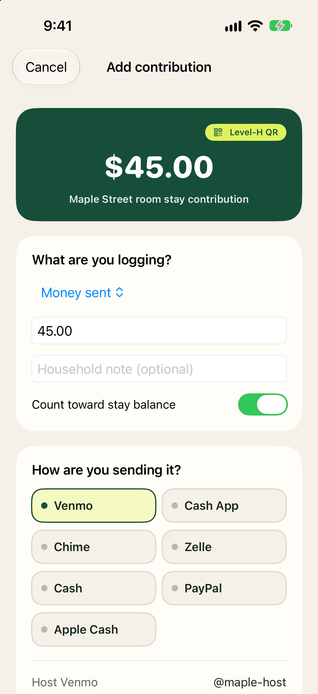
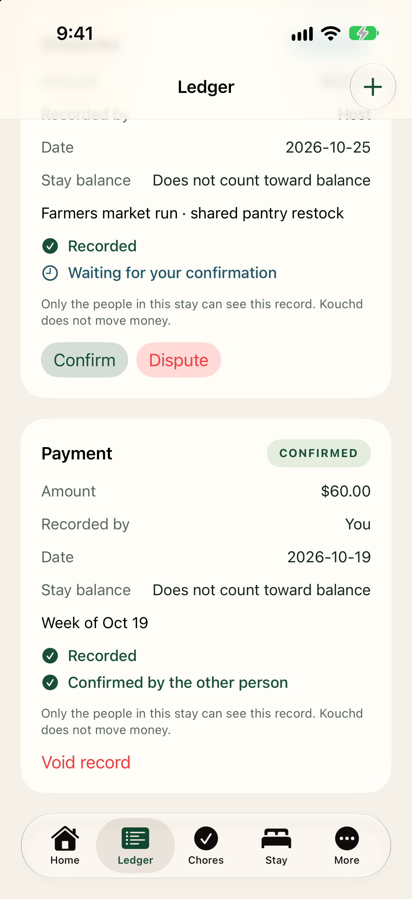
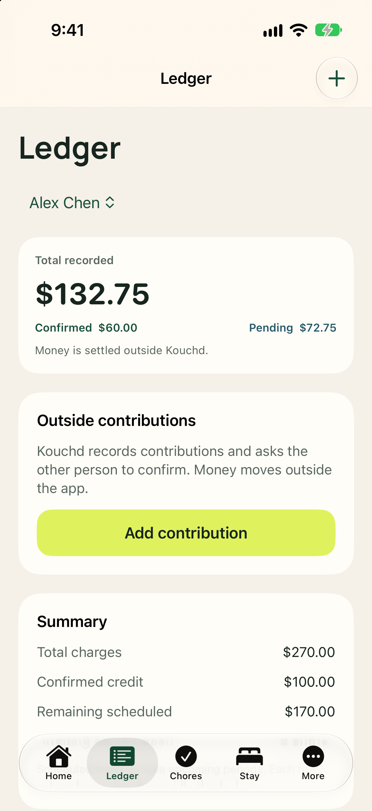

The **Ledger** tab keeps household financial obligations clear and transparent. Kouchd does not hold, process, or move money. Instead, you pay outside Kouchd using your host's payment methods (like Zelle, PayPal, or Cash App), then record it here as a shared contribution record. Contribution records do not prove that money moved.

## Recording a contribution

A contribution is a shared record of something you paid or provided outside Kouchd. The recording flow adapts based on whether you are logging money sent or non-payment contributions.

### Logging an outside payment (Money sent)

<Steps>
  <Step title="Open the Ledger tab">
    Tap **Ledger**, then tap the primary **Add contribution** button (or the **+** button at the top right).
  </Step>
  <Step title="Select Money sent and enter amount">
    Leave the type set to **Money sent**. Enter the dollar amount and an optional note. If you have earned house rewards, toggle **Apply rewards** to offset part of the amount.
  </Step>
  <Step title="Choose your payment method">
    Under **How are you sending it?**, tap the payment method you used or plan to use (such as Venmo, Cash App, Zelle, Apple Cash, PayPal, or Cash).
  </Step>
  <Step title="Send outside the app">
    - **For app payments (Venmo, Cash App, PayPal):** Tap to open the app with the amount ready, or scan the host's Level-H QR code.
    - **For bank or wallet transfers (Zelle, Apple Cash):** Copy the host's handle or phone number, then switch to your banking or Messages app to send the funds.
    - **For cash:** Hand the cash to your host or place it in the agreed spot.
  </Step>
  <Step title="Save to the Ledger">
    Return to Kouchd and tap **I sent it. Save to Ledger** (or **I handed it over. Save to Ledger** for cash). The entry is recorded as pending until the host confirms receipt.
  </Step>
</Steps>

### Logging non-payment contributions (Groceries, Supplies, etc.)

<Steps>
  <Step title="Choose contribution type">
    In the contribution sheet, select **Groceries**, **Supplies**, **House work**, or **Other**.
  </Step>
  <Step title="Enter details & balance credit">
    Enter the dollar amount spent and add a description. Keep **Count toward stay balance** turned on if this should reduce what you owe, or turn it off for purely informational records.
  </Step>
  <Step title="Log on Ledger">
    Tap **Log on Ledger**. The contribution is immediately saved as pending with "Waiting for the other person to confirm."
  </Step>
</Steps>

## Confirming or disputing a contribution

When someone else records a contribution that involves you, it shows up under **Contribution records** in the Ledger with **Confirm** and **Dispute** buttons.

- **Confirm:** Tap **Confirm** if it matches what was exchanged. Confirmed contributions that count toward the balance are credited to your oldest outstanding charge (including an upcoming charge when earlier charges are fully covered).
- **Dispute:** Tap **Dispute** if something looks off. Then talk it through with the other person. If the details were wrong, the person who recorded it (or the host) can tap **Void record** and record it again correctly. Kouchd does not mediate payment disputes or resolve stay conflicts between members.

<Note>
  Inline contribution disputes and record voiding are native-only features in the iPhone app. On the web app, mismatched records are left unconfirmed while coordinating a re-recorded contribution.
</Note>

## Host ledger controls

Hosts managing multiple guests can tap the guest switcher at the top of the Ledger to view contributions and records for each guest individually, with complete bilateral privacy between guests. Hosts can also adjust or void shared expense entries as needed.

## Related guides

<CardGroup cols={2}>
  <Card title="Getting started on iPhone" icon="mobile" href="/help/ios/using-kouchd-on-ios">
    App navigation, signing in, and notification settings.
  </Card>
  <Card title="Chores & stay details on iPhone" icon="list-checks" href="/help/ios/chores-and-stay">
    Household chore assignments, guidelines, and house notes.
  </Card>
</CardGroup>
